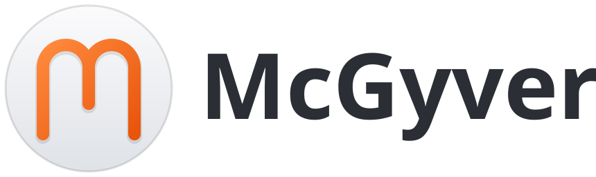

<picture>
  <source media="(prefers-color-scheme: dark)" srcset="assets/logo-on-dark.svg">
  
</picture>

# McGyver (prototype)

A file wheel for KDE Plasma 6, macOS and Windows, written in Rust with
[egui](https://github.com/emilk/egui). Drag files in your file manager and hold Shift: a wheel
opens around the cursor with what those files can become: other formats, smaller, resized,
merged, zipped, shared. Drop them on a wedge and it's done, without opening another app.

**This is a prototype.** Done for real:
- [pictures](#pictures)
- image tools (compress, resize, square crop, rotate, strip EXIF)
- [compressed files and folders](#compressed-files)
- [audio and video](#audio-and-video) conversions and tools: trim, normalize, compress, merge,
  mute, rotate, stills (with FFmpeg installed)
- [office documents and PDFs](#office-documents-and-pdfs) without LibreOffice: Word, Excel and
  PowerPoint files to PDF and to other formats of their own kind (Word to ODT, Excel to CSV…);
  documents and spreadsheets merged, presentations' pictures compressed; PDFs to Word,
  PowerPoint, their tables, EPUB, text and page images, and compressed, rotated, split and merged
- [subtitles and folders](#subtitles-and-folders): SRT, VTT and text, moved in time; folders
  flattened
- Word (DOCX, DOC, ODT, RTF), Excel (XLSX, XLS, ODS, CSV), PowerPoint, EPUB and text PDFs to
  Markdown (MD), with
  [anydoc](https://github.com/firecrawl/anydoc): pure Rust, nothing leaves the machine; a scanned
  PDF says it has no text, since OCR would mean a cloud service
- every [action](#actions); Share sends to your phone and to WhatsApp, Telegram, Slack and Teams
- [the wheel without files](#the-wheel-without-files): hold Shift on its own to switch to an open
  app (as Alt+Tab does), for what is playing, the keyboard and the computer's language, the
  volume, the brightness, screenshots and recordings, how busy the computer is, and switches for
  the whole computer (lock, dark mode, stay awake, the microphone, the trash, sleep)

Everything the wheel offers is done for real. It runs on **KDE Plasma 6 (Wayland)**, and on
**macOS** and **Windows** as first ports (see [macOS](#macos) and [Windows](#windows)).

## Run

```sh
cargo run --release                # the app, in the background with a tray icon; MCGYVER_DEBUG=1 logs
cargo run --release -- --settings  # the settings window (also from the tray, or by starting it again)
cargo run --release -- --quit      # quits the running app
cargo run --release -- --install   # once: wheel opens at once; tapping Shift opens it without a drag
```

Packages for the Snap Store, Debian/Ubuntu and Fedora: see [PACKAGING.md](PACKAGING.md).

### macOS

A first port, in testing on Apple Silicon. Build the app on a Mac (needs Xcode's command line
tools, `xcode-select --install`, and Rust from [rustup.rs](https://rustup.rs)):

```sh
packaging/macos/build-app.sh          # → dist/McGyver.app and dist/McGyver-<version>-universal.dmg
packaging/macos/build-app.sh arm64    # or x86_64: one architecture, about twice as fast to build
open dist/McGyver.app
```

The universal app holds both an Apple Silicon and an Intel build, so the same `.dmg` runs on any
Mac with macOS 11 or later; either Mac can build it. On a Mac other than the one that built it,
macOS refuses an app that isn't notarized: after copying it to Applications, run
`xattr -dr com.apple.quarantine /Applications/McGyver.app` once (or Control-click it → Open).

It sits in the menu bar (Pause, or Resume while paused, Settings…, Quit); there is no Dock icon,
and opening the app again while it runs opens its settings. Drag files in Finder, hold the
trigger key, and the wheel appears under the pointer (kept on the display near an edge). It is
drawn in a transparent window that is always there, on every Space and over full-screen apps,
and lets every click through until files are dragged and the key goes down; it then takes the
drag with macOS's own drag and drop. Holding the key while dragging something that isn't files
(a shape, some text) does nothing. What differs from KDE:

- **Trigger key:** Shift, Control, Option or Command. Control and Command change what a drag
  offers (a link, a move); the wheel accepts those too. Letting go of the key and the button
  together drops on the wheel; the key alone folds it.
- **Input Monitoring:** asked for on the first start (macOS shows its prompt once; the settings'
  Permissions card has **Ask** and **Open System Settings**, and comes first until it's allowed).
  With it, an event tap that only listens hears the trigger key and the mouse as they change,
  and nothing runs while nothing happens. Without it McGyver still works, reading the keys' and
  the mouse's state every 30 ms. Allowed while McGyver runs, it takes a restart: the card says so
  and has **Restart McGyver** (the running app writes how it hears the keys into its lock file;
  the settings ask for a restart through a `restart` file, which it takes once nothing is
  converting). The build script signs ad hoc builds with the bundle identifier as their
  designated requirement, so the permission outlives a rebuild; a build signed before that
  needs McGyver removed from the Input Monitoring list (−) and allowed again.
- **No tap without a drag:** tapping the key on its own does nothing, and finished files aren't
  selected in Finder.
- **Actions:** Copy and Move ask for a folder with macOS's own picker, Copy Path uses `pbcopy`,
  Terminal opens Terminal.app; Share isn't offered. The click plays through `afplay`.
- **FFmpeg** for audio and video: `brew install ffmpeg`. The app looks in `/opt/homebrew/bin` and
  `/usr/local/bin` too, which an app opened from Finder doesn't otherwise see.
- **Files:** settings in `~/Library/Application Support/McGyver/settings.conf`; Start at login
  writes `~/Library/LaunchAgents/io.github.ferdiunal.mcgyver.plist`, and asks for the app to be
  in Applications first (run from the disk image, macOS runs a copy that is gone by the next
  login). Converting onto a disk without exclusive renames (exFAT, FAT, SMB) works too.

The script signs the app ad hoc, which only runs on the Mac that built it, and a permission granted
to one build is lost with the next. To keep it, make a code signing certificate once (Keychain
Access → Certificate Assistant → Create a Certificate…, type "Code Signing") and build with
`MCGYVER_SIGN_IDENTITY="its name" packaging/macos/build-app.sh`. Handing the app to others needs
an Apple Developer ID and notarization, not set up yet.

### Windows

A first port, not yet run on a real Windows machine, for x64 and ARM64 PCs (Windows 10 and 11).
It is built on Linux with [cargo-zigbuild](https://github.com/rust-cross/cargo-zigbuild) (zig
brings MinGW's headers and libraries for both):

```sh
rustup target add x86_64-pc-windows-gnu aarch64-pc-windows-gnullvm
packaging/windows/build.sh          # → dist/McGyver-<version>-windows-x64.zip and -arm64.zip
packaging/windows/build.sh arm64    # or x64: one of them
```

Unzip it anywhere and run `McGyver.exe`. It isn't signed, so SmartScreen warns the first time
(More info → Run anyway). It sits in the notification area (Pause, or Resume while paused,
Settings…, Quit), and starting it again while it runs opens its settings. Drag files in
Explorer, hold the trigger key, and the wheel appears under the pointer, as on macOS: a
transparent, topmost window that lets every click through until the key goes down during a drag,
then takes the drag with Windows' own drag and drop. What differs:

- **Trigger key:** Shift, Ctrl or Alt.
- **No permission:** low-level keyboard and mouse hooks hear the key and the mouse as they
  change, and Windows asks nothing for them (if they can't be set, the state is read every
  30 ms). The settings' Permissions card says so.
- **Any drag:** Windows can't tell what a drag carries before it reaches a window, so the key
  takes whatever drag it goes down in. When no files come once the pointer has moved on, the
  drag goes through to what is below; pressing the key again takes it again.
- **Actions:** Copy and Cut are Explorer's (Ctrl+V pastes them; cut files are moved); Copy To and
  Move To ask with Windows' folder picker; Copy Path uses the clipboard directly; Terminal opens
  Windows Terminal, or else Command Prompt; Share needs KDE Connect's `kdeconnect-cli` on the
  PATH. The click plays from memory (`assets/sounds/click.wav`).
- **FFmpeg** for audio and video: `winget install Gyan.FFmpeg`, or any `ffmpeg.exe` on the PATH.
  HEIC and AVIF need libheif's `heif.dll` next to `McGyver.exe` or on the PATH.
- **Files:** settings in `%APPDATA%\McGyver\settings.conf` (a `mcgyver` folder from an earlier
  version is renamed); Start at login writes `McGyver` under
  `HKCU\Software\Microsoft\Windows\CurrentVersion\Run`, and asks for the zip to be unzipped
  first (opened from inside it, Explorer runs a copy that is gone later).
- **OpenGL 2.0 or later:** the wheel is drawn with OpenGL. Where Windows has only its own
  OpenGL 1.1 (a virtual machine without 3D acceleration, Remote Desktop, a PC without its
  graphics driver), the x64 app starts again on Mesa's software OpenGL (llvmpipe), which the zip
  carries in `opengl\`: from a hard link to itself in that folder, since Windows takes
  `opengl32.dll` from the exe's folder only as a process starts. Windows on ARM gets OpenGL from
  the graphics driver or from Microsoft's "OpenCL, OpenGL, and Vulkan Compatibility Pack"
  (Microsoft Store).
- **Log:** what goes wrong is written to `%APPDATA%\McGyver\McGyver.log`: errors, panics with
  their backtrace, and the OpenGL version and driver the wheel got. When it can't start at all, a
  message box says why. With `set MCGYVER_DEBUG=1`, started from a terminal, it writes to that
  terminal instead (after the prompt, which doesn't wait for it).

### Tray and settings

The app runs in the background with an icon in Plasma's system tray. Its menu has **Pause** (the
trigger key does nothing until **Resume**, which takes its place; the icon fades), **Settings…**
and **Quit**; clicking the icon opens the settings too. Starting the app while it runs opens its
settings instead of a second copy (it holds the session-bus name `io.github.McGyver`), and only
one settings window opens at a time. Quit waits for running conversions to finish.

The settings window saves each change at once, to
`~/.config/mcgyver/settings.conf`, and the running app picks it up straight away:

- **Appearance:** light or dark glass, or like the system (followed as it changes, within a
  second); the settings window follows too. Like the system, a click on the wheel's own Dark
  Mode turns the open wheel with it, as the desktop turns. A change of look fades across in
  under half a second: the glass blends, and the text fades out halfway and back in as the
  other colour, so it never sits grey on grey. On KDE, KWin fades the whole screen across when
  the colours change (its Blend Changes effect: a still of every window, held while they
  repaint, then blended into them); the wheel's Dark Mode starts that fade itself before the
  colours switch and turns the wheel at once beneath the still, so the wheel goes across with
  everything else instead of being caught halfway by it. With that effect off, the wheel fades
  on its own once the colours have switched.
- **Language:** English or Türkçe; the first time, the desktop's language. The wheel, the cards,
  the tray menu and the settings change; format names, file names and an engine's own error
  messages stay as they are.
- **Trigger key:** Shift (the default), Ctrl or Alt: held during a drag it opens the wheel, tapped
  on its own it opens the wheel for Dolphin's selection. Changing it also moves the KDE shortcut
  for the tap. Meta isn't offered: Plasma opens its launcher when Meta is tapped.
- **Without files:** holding the trigger key on its own opens the
  [wheel without files](#the-wheel-without-files); on by default. **Opens after** sets how long
  it is held first: 0.2 to 1.5 s, 0.45 s by default.
- **Quick Apps:** the apps on that wheel's Apps, with their icons, up to eight: ↑ and ↓ change
  the order, ✕ takes one off, and the tiles under them (narrowed as you type) add one.
- **Start at login:** writes `~/.config/autostart/mcgyver.desktop`.
- **Permissions:** what KWin and KDE actually granted the running app, checked every second,
  each with the button that fixes it. "Opens at once under a drag" is KWin's fake input;
  "Opens when the trigger key is tapped alone" is the KDE shortcut. Not set up → **Set up**
  (what `--install` does, below); set up but not granted yet → **Restart**; still not granted
  after that restart → "Still not allowed" and **Set up** again; app not running → **Start**;
  key held by another shortcut → **Open shortcuts** (Plasma's page) and **Try again**; a
  compositor that can't share Dolphin's selection → said so, nothing to press. **Remove** is
  `--uninstall`. While something is missing the card comes first; once
  all is granted it moves to the bottom and says so. KWin reads a new desktop file a few
  seconds late, so Set up and Remove wait until a fresh Wayland connection shows the change
  before restarting the app (once nothing is converting). KDE turned out to give a modifier
  tapped alone to two shortcuts at once, so "held by another shortcut" may never show there.
- **About**, at the bottom: the version, who made McGyver with their e-mail, GitHub and website,
  and a banner to sponsor it on GitHub Sponsors. The links open in the browser (or the mail app).

The rest of this README says Shift for the trigger key.

`--install` does two things, both undone by `--uninstall`:

- It writes `~/.local/share/applications/mcgyver-kwin.desktop` so KWin offers
  this binary its fake-input protocol (see below). If the binary moves, the app rewrites it when
  it starts (a snap's points at its `current` revision). Without it, the wheel opens as soon as
  the mouse moves after you press the key. The entry names the app icon, which goes to
  `~/.local/share/icons/hicolor/scalable/apps/mcgyver.svg`: KWin finds a window's icon only in
  the desktop file named after its app id, so without a package's `mcgyver.desktop` the settings
  window goes by `mcgyver-kwin` and shows the icon on its title bar.
- It binds a KDE global shortcut, "McGyver", to the trigger key on its own. It shows up in
  System Settings → Shortcuts, but the trigger key in the app's settings wins: the app binds it
  again when it starts.

Start dragging a file, then hold Shift. The wheel opens on Convert; the ring around its centre
switches between the three modes:

| Mode | Wheel |
|------|-------|
| Convert | To another format; Unzip first for archives |
| Tools | Compress, trim, rotate, split, merge… |
| Actions | Zip, copy, cut, copy to, move to, copy path, terminal, share, messaging apps |

- **The mode ring:** the hub is a ring of three slices around a white centre: Convert at the top,
  Tools at the lower right, Actions at the lower left, each named along its curve. The current
  mode is raised white. Stop on
  another slice, or move along the ring into it, and the wheel switches to that mode at once, so
  you can start with Shift on a picture and still zip it. Passing over a slice on the way out to
  a wedge (or back in) doesn't switch. After a switch, move a little before dropping.
- **Motion:** everything moves on springs, running a little past where it goes and settling
  back. The hub pops open first, a droplet comes round it and merges in, and the disc grows out
  of it; its wedges unfold out of the centre one after another (again after a mode switch), the
  wedge you aim at swells outward with the frame bulging around it, and the centre's text slides
  over to the format you would get. A click flicks the hub toward it, and it springs back
  (`src/motion.rs`).
- **The first start** opens the wheel on its own in the middle of the screen, slowly, with how
  to open it underneath; it takes no clicks and goes after a few seconds.
- **Long names** on a wedge break onto two lines ("Şuraya / kopyala") rather than spill over.
- **Drop on an option wedge:** the wedge flashes, the wheel folds, and a card slides in at the
  bottom right of the screen, as a notification does. It shows progress, then a check mark and
  the new file's name (or a red mark and the reason it failed), then fades; not while the pointer
  is on it. Cards stack, the newest at the bottom.
- **The card:** its × cancels the work: FFmpeg is stopped,
  a merge stops between two files, and nothing is put in place after a cancel (files already
  finished in that batch stay). On a finished card the × puts it away. Only the cards take the
  pointer; the rest of the screen stays clickable. A merge counts its files on the progress ring.
- **Finished outputs:** real conversion and tool jobs ask the active Dolphin window, or the window
  already showing an output folder, to select the files they made. A batch sends one request for all
  successful outputs; failed jobs are skipped. If needed, Dolphin opens their folders
  in tabs in that same window. If no matching existing window is available, selection is skipped.
- **Drop on the centre, the ring or off the wheel:** the drag is cancelled.
- **The centre** shows the file's size (or how many files); while aiming at an option, the format
  or action you'd get.
- **Letting go of Shift** closes the wheel; the drag carries on, and pressing Shift again
  reopens it.
- **Only modes with options:** a mode with nothing for these files gets no slice, and the wheel
  opens on the first mode that has something. With three modes the ring is in thirds, with two
  in halves (the first on top), and with one there is no ring at all: a JSON file, say, opens
  straight on its Actions.
- **Sound:** the wheel opening, a mode switch, moving onto another wedge and a pick each play
  `assets/sounds/click.mp3` through `pw-play` (or `paplay`; `afplay` on macOS; PlaySound and
  `click.wav` on Windows). `MCGYVER_SOUND=0` turns it off.
- **Merge** (documents, spreadsheets, PDFs, audio) shows up only with two or more files; a single
  document has no other tool, so it gets no Tools slice at all.
- **Mixed selections:** the wheel offers what every recognised file supports. A file already in
  the target format counts as supporting it. Unrecognised files are skipped.
- **Without a drag:** select files in Dolphin and tap Shift on its own (down and up, nothing else
  in between). The wheel opens at the pointer for those files; click an option, or click a ring
  slice to switch modes. A click anywhere else, a right click or another Shift tap closes it.
  Typing capitals and Shift-clicking don't count as taps.

## The wheel without files

Hold Shift on its own a moment, with no drag (0.45 s unless the settings say otherwise): the
wheel opens around the pointer for the desktop rather than for files.

| Mode | Wheel |
|------|-------|
| Apps | The apps open, as Alt+Tab (Cmd+Tab) shows them: the one used last on top, the one in front last; an app with several windows pops them out as numbered bubbles. Then your quick apps that aren't open. With none of either, "Choose apps…" opens the settings |
| Media | Only while a player plays or is paused: Play or Pause on top, then Next, Repeat, the player itself (brings it forward), Shuffle, Previous. The caption is the track |
| Everyday | Keyboard (with two layouts or more; on KDE also the layouts your languages want, added when picked), Language (the computer's, from the next login), Volume, Brightness, Screenshot (an area, the screen or a window), Record (an area or the screen) and Monitor (processor, memory and disk as rings, red when nearly full; a click opens the system's monitor), whichever the system has |
| System | Lock, Dark Mode, Stay Awake (keeps the screen on while McGyver runs), Microphone, Empty Trash, Desktop (not on macOS) and Sleep. A switch has a dot under its name, lit while on |

It opens on Apps; the ring has a slice per mode, Apps at the top. While Everyday or System is
open it is read again every second, so the load and the switches stay current. Empty Trash and
Sleep take a click: letting go of Shift on them only closes the wheel. Holding Shift with files
or folders selected in the file manager (Dolphin, Finder, Explorer) opens nothing: that Shift is
for selecting more.

- **Options as bubbles:** aiming at Keyboard, Volume or Brightness pops their options out past the
  wedge, one after another: the layouts (EN, TR, DE…), a speaker that mutes or unmutes and 25 to
  100 %, or 10 to 100 %. The one in use is ringed.
- **While Shift is held**, a click does what the wedge or bubble under it does and the wheel
  stays; it reads the system again, so Play turns into Pause and the ring moves to the new
  level. Opening an app (or the player) closes it. A right click closes it.
- **Letting go of Shift** does what is aimed at, unless a click already did something; on
  nothing, it just closes.
- **On KDE** players come over MPRIS, the layouts from KWin (`org.kde.keyboard`), the volume
  from PipeWire's `wpctl` (or PulseAudio's `pactl`), the brightness from Plasma's screen
  brightness service (or PowerDevil's older one), and apps from their desktop files (started
  with `gio launch`, `kioclient` or `gtk-launch`). Plasma lets no app see the other keys and the
  clicks, so holding Shift that long for a Shift-click, Shift and the arrows, or a run of
  capitals opens it too; Shift with another modifier (Ctrl+Shift…) doesn't. The settings' **Without
  files** turns it off. Holding Shift and then starting a drag gets the files' wheel.
- **On macOS** Spotify and Music are driven with AppleScript (macOS asks once whether McGyver may
  control each), the volume too; the layouts are
  the keyboard input sources; there is no Brightness, as macOS has no public way to set it; apps
  come from the Applications folders and open with `open`. Another key or a click while Shift
  is held is a shortcut or a Shift-click, and nothing opens. Screenshots go through
  `screencapture` (macOS asks once for screen recording) where macOS keeps them; Record opens
  the Screenshot app's bar. The language is `AppleLanguages`, the microphone its input volume,
  dark mode System Events, Stay Awake `caffeinate`, Lock and Sleep `pmset`, the trash Finder.
- **On Windows** the player is whichever the media controls show (the ones above the volume
  flyout), the volume the default speakers', the layouts the input languages, the brightness a
  built-in screen's (through WMI, read once ahead and then kept up to date behind the scenes),
  and apps the Start menu's, Store apps included. Another key or a click cancels it, as on macOS.
  Screenshots and recordings are Snipping Tool's own keys (Win+Shift+S, Win+PrtScn, and on
  Windows 11 Win+Shift+R); the language is the display language override, dark mode the
  personalisation setting, Stay Awake `SetThreadExecutionState`.
- **The apps open** come from KWin's scripting on KDE (the only way a Wayland client sees other
  windows), from the running apps on macOS, and from the windows Alt+Tab shows on Windows. Their
  icons come from the icon theme, AppKit or the shell (`src/icons/`).

## Pictures

Hold Shift over a picture to see JPG, PNG, WEBP, HEIC, AVIF, TIFF,
GIF, BMP, ICO and PDF. Its own format is left out, and so is any format this system can't write
(see HEIC below). The result goes next to the original, as for compressed files.

- **Read:**
  - JPEG, PNG, GIF, WebP, BMP, TIFF, ICO, TGA, QOI, PNM (`.ppm`, `.pgm`, `.pbm`, `.pam`), HDR,
    OpenEXR and DDS
  - HEIC/HEIF and AVIF
  - JPEG XL
  - SVG/SVGZ, drawn at 1024 px on the long side or more
  - Photoshop (PSD/PSB, the merged image)
  - camera RAW: CR2, CR3, NEF, ARW, DNG, RAF, ORF, RW2 and about 20 more, developed with
    rawler's defaults
- **Kept:**
  - Photos taken sideways come out upright, and their Exif no longer asks to turn them again.
  - The colour profile (a Display P3 iPhone photo stays P3) goes to JPG, PNG, WebP, TIFF, HEIC,
    AVIF and PDF.
  - Exif (date, camera, location) goes to JPG, PNG, WebP, HEIC and AVIF.
- **Choices:**
  - JPG uses quality 90. Transparency becomes white.
  - WebP is lossy (quality 82) from photos and lossless from graphics.
  - HEIC uses quality 80 and AVIF 70.
  - TIFF is lossless (Deflate) and keeps 16 bits.
  - ICO holds 16–256 px squares.
  - PDF is one page at 96 dpi. A JPEG goes in unchanged, other photos as JPEG, graphics
    losslessly with their transparency.
- **Tools:** Compress exports WebP; Resize caps the long edge at 2048 px; Crop makes a centered
  square; Rotate turns the image 90°; Strip EXIF removes the EXIF block while preserving the
  colour profile. Pixel edits keep the source format when it has a writer and otherwise export
  PNG. Each tool writes a separate file beside the original.
- **HEIC and AVIF** go through the system's libheif, loaded at run time, so building needs
  nothing. Fedora's libheif can't open or save HEIC (the HEVC codec is patented):
  `sudo dnf install libheif-freeworld` (RPM Fusion) adds it. Until then the app says so at
  start, and the HEIC wedge stays hidden. AVIF works with the stock plugins.
- **Safety:**
  - A picture may decode to at most 1 GiB. A file whose header claims more is refused, so a
    tiny crafted file can't exhaust memory.
  - An SVG may only use pictures from its own folder.
- **Not yet:** animated GIF and WebP keep only their first frame. Multi-page TIFF keeps only
  its first page.

## Audio and video

With FFmpeg installed (see [Run](#run)), Convert saves audio as MP3, M4A, WAV, FLAC, OGG, OPUS
or AIFF and video as MP4, MOV, MKV, WEBM, GIF or MP3, keeping the tags and chapters. The card
fills as FFmpeg gets through the file, and its × stops FFmpeg.

| Drag | Tools |
|------|-------|
| Audio: MP3, M4A, WAV, FLAC, OGG, OPUS, AIFF, WMA | Trim (the silence at the start and the end), Normalize (even loudness, EBU R128 at -16 LUFS), Compress, Merge |
| Video: MP4, MOV, MKV, WEBM, AVI, WMV, M4V | Compress, Trim (the black at the start and the end), Mute, Rotate (a quarter turn clockwise), Frames |

- **Names and formats:** "song (trimmed).mp3", "clip (muted).mp4"… in the file's own format where
  FFmpeg writes it, else M4A or MP4 (an AVI comes out MP4). What the file holds decides, not its
  name: a .webm with sound alone is treated as audio. Mute copies the picture as it is, into the
  same kind of file, leaving data tracks (a phone's or an action camera's readings) out.
- **Compress** lowers the bit rate (MP3 96 kb/s, AAC 96 kb/s, Opus 64 kb/s, Vorbis quality 2)
  and fits video into 1080p; WAV, AIFF and FLAC become M4A. It fails rather than make a file
  that is no smaller.
- **Trim** finds the ends with FFmpeg's silence or black detection (quieter than -50 dB for half
  a second, or black for a tenth, ending within half a second of the end), then cuts there; it
  says so when there is nothing to cut.
- **Merge** joins the tracks in the order they were dragged into "first (merged)" in the first's
  format.
- **Frames** saves a still a second as JPEGs into a folder "clip (frames)", or 100 spread over a
  video longer than 100 seconds.
- **H.264** is made with x264 where FFmpeg has it, else OpenH264 (Fedora's ffmpeg-free has only
  that) at a bit rate for the picture's size, else FFmpeg's own MPEG-4. A picture with an odd
  side loses a pixel there, as 4:2:0 needs even sides.

## Subtitles and folders

- **Subtitles:** SRT, VTT and TXT. WebVTT's escapes, voices and classes are turned into SubRip's
  plain text, and the other way round SubRip's `{\an8}` positions and font colours are dropped;
  italic, bold and underline stay. TXT is the words, a cue to a line, a line held over several
  cues written once. A file in an older encoding (Windows-1254 or -1252, say) is recognised and
  saved as UTF-8. Blank lines holding spaces, and cues with no blank line between them, are read
  as hand-edited files have them.
- **Shift** pops out −1 s, −0.5 s, +0.5 s and +1 s; drop on one to move every cue that much,
  into "film (+0.5 s).srt". Only the times change: positions, settings, styles and a WebVTT's
  header stay. Cues moved before the start are dropped.
- **Flatten** copies every file in a folder and the folders inside it, side by side into
  "photos (flat)", keeping their dates. A name met twice gets a number ("beach 2.jpg"), the one
  nearer the top keeping it. The folder itself is left as it was.

## Office documents and PDFs

The engines of four open-source "craft" apps do this work, in pure Rust (MIT OR Apache-2.0), so
nothing needs to be installed:
[WordCraft](https://github.com/storytold/wordcraft),
[GridCraft](https://github.com/storytold/gridcraft),
[DeckCraft](https://github.com/storytold/deckcraft) and
[PdfCraft](https://github.com/storytold/pdfcraft).

| Drag | Convert | Tools |
|------|---------|-------|
| Word: DOCX, DOC, ODT, RTF, HTML, Markdown, TXT | PDF, DOCX, ODT, RTF, HTML, TXT; MD for DOCX, DOC, ODT, RTF | Merge |
| Spreadsheet: XLSX, XLS, ODS, CSV, TSV | PDF, XLSX, CSV, TSV, HTML; MD for all but TSV | Merge |
| Presentation: PPTX (ODP for Compress) | PDF, PPTX, TXT (the outline), MD | Compress |
| PDF | DOCX, PPTX, XLSX (its tables), EPUB, TXT, JPG, PNG (a page each), MD | Compress, Rotate, Split, Merge |

- **Names:** the result goes next to the original as for pictures: "report.pdf",
  "report (compressed).pdf", "report (rotated).pdf". Split makes a folder "report (pages)" holding
  "report 1.pdf", "report 2.pdf"…; Merge makes "first (merged).pdf" from the PDFs in the order
  they were dragged, with a bookmark for each, and skips files the wheel doesn't recognise.
- **A PDF as something else:** Word and PowerPoint come from each page's paragraphs (headings
  where the text is set larger, bold and italic, colours) and pictures, through PdfCraft's
  export; PowerPoint makes a slide of each page. EPUB holds the same as one chapter, its
  pictures as files and its headings as the contents. XLSX makes a sheet of each table PdfCraft
  finds on the pages, numbers as numbers, and says so when there are none. TXT is the paragraphs
  with a blank line between them; the words a scan's recognition left invisible over it count,
  and a scan without any says it has no text. JPG and PNG draw each page at 150 dpi on white
  with PdfCraft's renderer: one page gives "report.png", more a folder "report (pages)" of
  "report 1.png", "report 2.png"…. A password-protected PDF is left alone, as for Split.
- **Merging documents** puts them one after another in the first one's format (DOCX where
  WordCraft can't write it, such as DOC or Markdown), each from a new page, with what each brings:
  its pictures, lists, the styles the first lacks (where both have one, the first's wins),
  footnotes, comments, text boxes and tracked changes. Each keeps its page setup (a section
  break closes the one before), and takes the headers and footers before it, as Word's sections
  do when linked to the previous one. Merge is offered for files of one kind only.
- **Merging spreadsheets** puts every sheet of each into one XLSX, in order. A sheet whose name is
  taken gets a number ("Data (2)"), and what its workbook says of it follows: formulas, charts,
  names, sparklines, validations and conditional formats. Names come along; a workbook-wide
  name the first already has is given to each of that workbook's sheets instead, which their
  formulas find first. Dates from a workbook counting from 1904 are moved to the first's count.
  Tables, pivot tables and slicers stay behind (their names must be unique in a workbook); their
  cells come along.
- **Compressing a presentation** (PPTX or ODP) scales its JPEG and PNG pictures down to 1920
  pixels on the long side and saves them again, JPEG at quality 80; each keeps its format and
  name and colour profile, and every other part of the file is copied byte for byte. A picture
  that needn't be scaled is saved again only for a tenth off, so compressing twice doesn't wear
  it down; a photo its Exif turns is left alone; and a presentation that comes out no smaller
  fails rather than make a copy.
- **PDF tools leave signed PDFs alone** (a signature field with a value, or a certified PDF):
  what they made would carry a broken signature. Split and Merge also leave password-protected
  PDFs alone, since the new files would come out unprotected. Compress fails rather than make a
  file that is no smaller, and a PDF whose page list is lost has it rebuilt from the pages found
  in the file. A failed Merge names the file that stopped it.
- **Spreadsheets:** CSV, TSV and HTML hold the active sheet; PDF prints every visible sheet with
  something on it. GridCraft prints at most 2000 pages, so a longer one fails instead of being
  cut short.
- **They are alpha software.** Layout is close to Office but not identical (their own estimates
  put them at 50–60% of the way to replacing Office), and a file one can't read fails with its
  message. Each reads the whole file into memory, so files over 512 MiB are refused, and so is a
  Merge of PDFs that are larger than that together.
- **Build:** they aren't on crates.io, so Cargo fetches them from GitHub at pinned commits. The
  first build takes a few minutes longer, and the release binary grows from about 47 MB to
  about 117 MB (93 MB stripped), the renderer and the export included.
- **PdfCraft's renderer** draws with PdfCraft's own copy of hayro, hardened against damaged
  files; a dependency's patches don't carry over, so `Cargo.toml` repeats them from the same
  commit.
- **`vendor/epaint`:** WordCraft and DeckCraft switch on vello_cpu's multithreading, which
  breaks how egui's epaint 0.37.0 draws glyphs (it never flushes). The copy there draws them
  single-threaded; drop it once epaint does.

## Actions

The Actions slice of the ring opens the actions. They work on the whole selection, files and
folders alike:

| Action | What it does |
|--------|--------------|
| Zip | Packs everything into one ZIP next to it: `name.zip` for one item, `Archive.zip` for several |
| Copy, Cut | Puts the files on the clipboard as Dolphin's Ctrl+C and Ctrl+X do (a URI list, KDE's cut mark, GNOME's form, and the paths as text), through ext-data-control; paste them in a file manager. Cut files are moved where they are pasted. Without ext-data-control, Copy goes through wl-copy as a URI list and Cut isn't offered. On macOS, Copy is Finder's Copy and there is no Cut (Option-Command-V moves what was copied); on Windows they are Explorer's |
| Copy To, Move To | Asks for a folder (kdialog or zenity; the system's picker on macOS and Windows) and copies or moves there. Names that are taken get a number. Copying into the same folder duplicates; moving there changes nothing. A move to another disk copies, syncs to disk, then removes the original |
| Copy Path | Puts the full paths on the clipboard, one per line (wl-copy, or Klipper; pbcopy on macOS) |
| Terminal | Opens Konsole (or the first terminal found; Terminal on macOS, Windows Terminal or Command Prompt on Windows) in the folder |
| Share | Sends the files to the first phone KDE Connect can reach. Aimed at, it pops out the phone and the messaging apps installed (WhatsApp, Telegram, Slack, Teams, with their icons) as bubbles; drop on one to send there |
| Share's messaging apps | Telegram opens its own "share with" window for the files, where you pick the chat (`-sendpath`; as a flatpak with the files forwarded in). The others take no files from outside, so the files go on the clipboard as a copy and the app comes up to paste them into a chat. Each shows up only when installed: found by its desktop file, its app bundle, or on Windows Telegram's own folder and the `whatsapp:`, `msteams:` and `slack:` links. A link in the browser can't take files, so a messaging app that isn't installed isn't offered. None of their links takes a file from the computer either: WhatsApp's click to chat (`wa.me`, `whatsapp://send`) takes a number and text, Teams' chat link (`msteams:/l/chat`) users, a topic and text, and Slack's (`slack://`) ids of workspaces, channels, users and files already in Slack |

An action only shows up if its tool is installed. Pinning a preview above other windows isn't
done yet.

## Compressed files

Archives, single compressed files and folders are converted for real. The result goes next to
the original. If that name is taken, a number is added ("photos 2.zip"). Work happens in a
hidden `.mcgyver-…` file or folder beside it and moves into place only when complete. A
failure cleans it up; only killing the app mid-way can leave one behind.

| Drag | Convert |
|------|---------|
| An archive | **Unzip**, ZIP, 7Z, TAR.GZ, TAR.XZ, TAR.ZST, TAR.BZ2, TAR |
| A compressed file | **Unzip**, GZ, XZ, ZST, BZ2, LZ4, or into a ZIP or 7Z |
| A folder | ZIP, 7Z, TAR.GZ, TAR.XZ, TAR.ZST, TAR.BZ2, TAR |

Archives have no tools, so their wheel has Convert and Actions only.

- **Read:**
  - ZIP (also `.jar`, `.apk`, `.cbz`…), 7Z (`.cb7`) and RAR (`.cbr`).
  - TAR on its own or compressed with gz, bz2, xz, zst, lz4, lzma, lz or br, including the short
    names (`.tgz`, `.tbz2`, `.txz`, `.tzst`, `.tlz`…).
  - The same eight codecs as single compressed files.
  - A file whose name says nothing (a `backup` with no extension, say) is recognised by its first
    bytes.
- **Written:** all of the above except RAR, whose format only RAR's own tools may write. The
  wheel shows the common targets; the rest (TAR.LZ4, TAR.LZMA, TAR.LZ, TAR.BR, LZMA, LZ, BR)
  work in code but have no wedge yet.
- **Unzip:** if the archive holds one file or folder at the top (or it's a `.gz` and the like),
  that goes next to the archive. Several go into a folder named after the archive.
- **Kept:** folders (empty ones too), the executable bit, modification times and symbolic links.
  Unpacked files end up as with `tar` and the usual umask: readable by their owner, writable by
  nobody else, never setuid.
- **Safety:**
  - Entry names that would leave the destination (`../…`) are skipped, and nothing is written
    through a link.
  - RAR hard links and file copies are made only from files the archive itself holds. unRAR
    alone would resolve them against the app's working folder.
  - Checksums are verified, including those after the end of a compressed tar.
  - An `.xz`/`.lzma` that asks for more than 1 GiB of memory is refused (`.lz` is capped at
    512 MiB by its format). Nothing limits how much disk an archive fills when unpacked.
- **Dragging a link to a folder** packs the folder it points to.
- **Changing only the compression** (TAR.GZ → TAR.ZST, GZ → XZ) streams the data without
  unpacking it.
- **Not yet:**
  - Password-protected archives fail with a message saying so.
  - File names that aren't valid UTF-8 are packed with `�` in place of the bad bytes.

Most image and archive processing uses Rust crates. WebP, zstd and unRAR include native code;
libheif is loaded at run time. Audio and video conversions use an installed `ffmpeg`. RAR support uses the official unRAR code,
whose licence allows use and sharing but not writing a RAR compressor. Build without it with
`cargo build --no-default-features`.

## How it works on KDE

No app can see another app's drag on Wayland. Plasma has two protocols that get around this
without root:

1. `org_kde_kwin_keystate` (v5) reports modifier presses to every client, whichever app has
   focus.
2. `zwlr_layer_shell_v1` lets a client put a fullscreen surface above everything.

As soon as Shift goes down, the app maps an invisible fullscreen overlay.

- **A file drag is in progress:** the drag now passes over the overlay. The compositor reports
  the position (`wl_data_device.enter`), and the app reads the dragged paths right away so the
  wheel can offer the right options.
- **No drag:** the pointer simply enters the overlay. The app removes the overlay again within
  a few milliseconds.

KWin only re-checks what is under a drag when the pointer moves, so a drag held still never
reaches the overlay. If neither answer comes within 15 ms of the overlay being mapped, the app
moves the pointer one pixel and back with `org_kde_kwin_fake_input` (up to three times), and the
drag finds the overlay at once. KWin only offers that protocol to programs whose desktop file
asks for it with `X-KDE-Wayland-Interfaces=org_kde_kwin_fake_input` and whose `Exec` is the
running binary, which is what `--install` sets up.

The app accepts the drag only while it points at a wedge. The cursor shows what will happen, and
releasing anywhere else cancels the drag. After a drop, the overlay's input region is emptied,
so the progress card lets clicks through.

A Shift tap without a drag comes from KDE's global shortcuts (KGlobalAccel, hosted by KWin),
which fire a modifier-only shortcut only when nothing else was pressed in between. The app
listens for the shortcut's D-Bus signal (`src/tap.rs`). Dolphin has no call that lists its
selection, so the app checks that the active Dolphin window's Copy action is enabled, triggers
it over D-Bus and reads the `text/uri-list` it puts on the clipboard. Before that it saves every
type the clipboard holds (text first, at most 0.4 s), and afterwards it serves them again,
through `ext-data-control` (`src/clipboard.rs`). The clipboard ends up as it was, with two
exceptions: Klipper's history keeps an entry for the copied files, and if the clipboard was
empty, Klipper may fill it with that entry. Then it maps the overlay; the pointer entering it says where to open the
wheel.

Rendering: one EGL context (glutin) and one `egui_glow` painter, drawn onto the layer surface
with [smithay-client-toolkit](https://github.com/Smithay/client-toolkit). There is no winit.
Quality: the context asks for 4× multisampling, since egui doesn't anti-alias the wedges' meshes
itself; the overlay draws at twice the screen's resolution on a 1× screen and KWin averages it
down, which smooths text as well; dithering keeps gradients and shadows free of banding; and
glyphs sit on whole pixels instead of egui's quarter-pixel positions.

The look (`src/glass.rs`):

- **Wheel:** a frosted light grey frame holding white, rounded wedges with gaps between them,
  around the hub: a grey mode ring, its current slice raised white, around a white centre.
- **Accent:** orange, only for the wedge you aim at.
- **Labels:** in Noto Sans Bold, bundled in `assets/fonts` under the OFL.

A client can't read the pixels behind it, so the compositor does the blur. Each frame the
overlay reports where it drew glass: the disc, the caption and the progress card. That region
goes to `ext_background_effect_v1`, approximated by 2 px horizontal bands. Compositors without
that protocol get the same look without the blur.

GNOME has neither protocol. macOS and Windows do the same with their own APIs (`src/desktop`):
they hear the modifier keys and the mouse, and a topmost window that lets clicks through takes the
drag under the cursor. X11 isn't written yet.

## UI development

The overlay UI (`src/overlay.rs`, `src/wheel.rs`) doesn't depend on the platform.
`examples/preview.rs` renders it in an ordinary window with a scripted drag:

```sh
cargo run --example preview -- hover     # wheel|hover|tools|actions|share|mixed|card|cards|archive|folder|failed|settings
cargo run --example preview -- desk      # desk|desk-apps|desk-media|desk-volume|desk-keyboard|desk-monitor|desk-system|desk-empty|welcome
EFRAME_SCREENSHOT_TO=out.png MCGYVER_LANG=tr WAYLAND_DISPLAY= xvfb-run -a cargo run --example preview -- card
```

`MCGYVER_LANG=tr` shows it in Turkish and `MCGYVER_DARK=1` dark, `MCGYVER_TURN=1` partway through
turning from light to dark (not in `settings`); `MCGYVER_AT=0.3` stops the clock 0.3 s in, to see a frame of the motion; `settings` opens the settings window, `MCGYVER_HEIGHT=1000` that tall. Clear `WAYLAND_DISPLAY`
for screenshots, or the window opens on the desktop rather than under xvfb.

### End-to-end test

`dev/e2e/run.sh` tests the real path headlessly:

1. Starts a nested KWin (`kwin_wayland --virtual`) with its own D-Bus and config directories.
2. A GTK window drags a file.
3. KWin's fake-input protocol moves the pointer and presses the modifiers, following
   `dev/e2e/scenarios/full.txt` (or another scenario: `run.sh still` presses Shift with the mouse
   held still, `FILE=photos.zip run.sh archive` converts and unpacks a real ZIP, and
   `run.sh real` turns a JPEG into a PNG, zips it, copies its path and opens Konsole,
   `run.sh ring` switches from Convert to Actions on the mode ring and zips the file,
   `run.sh clipboard` cuts and then copies the file from the Actions wheel and saves what the
   clipboard held in `out/clipboard-*.txt` (the cut mark should read 1, then 0),
   `SETUP=… FILE=clip.mp4 run.sh card` (the command is in `scenarios/card.txt`) finds the card
   at the bottom right and cancels its slow conversion with its ×, after which FFmpeg is gone and no
   `clip.webm` is left, and
   `SOURCE=dolphin run.sh tap` selects a file in Dolphin, taps Shift, clicks PNG and saves the
   clipboard afterwards in `out/clipboard.txt`, which should read "before the tap", and
   `run.sh settings` starts the app a second time (its settings open instead), switches the
   trigger to Ctrl and the language to Turkish, checks that Shift no longer opens the wheel and
   Ctrl does, pauses from the tray menu and quits with `--quit`, and
   `PERMISSIONS=1 run.sh permissions` keeps KWin's permission checks on, as on a real desktop
   (the other runs switch them off), and sets up and removes the KDE integration from the
   settings' Permissions card, and
   `run.sh desk` holds Shift with no drag, with a stand-in player on the nested bus
   (`dev/e2e/desk_services.py`, its calls in `out/desk.log`) and three keyboard layouts in the
   nested KWin: it opens on the apps (the nested KWin's windows), switches to Media and clicks
   Next, switches the layout to DE (`out/layout.txt` should read 2), sets the volume to 50 %
   through a stand-in `wpctl` (`out/wpctl.log`) and the brightness to 75 % through a stand-in
   of Plasma's brightness service (`SetBrightness 7500` in `out/desk.log`), shows System, lets
   go on Pause, and checks that a short press opens nothing, and
   `run.sh share` drops a file on Share's Telegram bubble (a stand-in Telegram logs
   `-sendpath` and the file to `out/telegram.log`) and on its WhatsApp bubble (the file's URI
   is on the clipboard, `out/clipboard-whatsapp.txt`), and
   `run.sh quickapps` moves the second of two quick apps up in the settings window, checks the
   order saved (`out/quick-order.txt`) and that the wheel's Apps follows it, and
   `run.sh dark` clicks System's Dark Mode twice: the nested session's colour scheme goes to
   BreezeDark and back (`out/scheme-1.txt`, `out/scheme-2.txt`) and the open wheel turns with it. PipeWire is pointed
   at nothing in every run, so the real volume is never touched. Every run starts after the
   welcome; `WELCOME=1` keeps it).
4. spectacle takes screenshots.

Logs, screenshots and the files the app made go to `dev/e2e/out/`. This test caught a bug that only showed on NVIDIA:
the context was first made current without a surface, which left the draw buffer at
`GL_NONE`, so nothing was drawn.

## Layout

| File | What |
|------|------|
| `src/kde.rs` | KDE Wayland backend: keystate, layer-shell overlay, drag and drop, clicks after a Shift tap or on the wheel without files, EGL rendering |
| `src/tap.rs` | The trigger-key tap global shortcut (KGlobalAccel over D-Bus) |
| `src/tray.rs` | The tray icon and its menu (StatusNotifierItem, through ksni) |
| `src/service.rs` | The app's session-bus name: one instance, and what the settings window and `--quit` ask it |
| `src/settings.rs` | The settings file, the trigger keys, starting at login |
| `src/settings_window/` | The settings window (eframe), run as `--settings`; its Permissions card per platform (`linux`, `mac`, `windows`) |
| `src/desktop/` | The macOS and Windows backend: the overlay window, the menu bar or tray icon, the input thread (`mod.rs`), and what differs (`mac.rs`, `windows.rs`) |
| `src/i18n.rs` | English and Turkish text; everything shown is looked up there |
| `src/icon.rs` | The app icon (`assets/icon.svg`) drawn for the tray and the window |
| `assets/icon.svg`, `assets/logo.svg`, `assets/logo-on-dark.svg` | The icon (a ring of wedges around a pointer, one wedge lifted out) and the logo with the name, its text turned into paths so it needs no font |
| `src/clipboard.rs` | Saving and restoring the clipboard with `ext-data-control` |
| `src/file_manager.rs` | Dolphin over D-Bus: select finished files, find and copy the active window's selection |
| `src/overlay.rs` | What the overlay shows: wheel state, drop handling, the welcome, the progress cards at the corner |
| `src/wheel.rs` | Wheel geometry, hit testing, painting |
| `src/motion.rs` | Springs: the wheel's pop, unfold and swell, worked out from the time |
| `src/glass.rs` | Colours, fonts, the frosted frame and capsules, blur-region geometry |
| `src/catalog.rs` | What each file kind offers (formats, tools, actions) |
| `src/jobs.rs` | Runs the work on a background thread, one job after another |
| `src/convert.rs` | What a wedge does to one file (picture, compressed file, folder), and merges; output names, scratch files |
| `src/images/` | Reading and writing pictures; libheif at run time (`heif`), WebP metadata (`webp`), PDF, PSD |
| `src/media.rs` | Audio and video conversions and tools through FFmpeg |
| `src/subtitles.rs` | SubRip and WebVTT read, written as either or as text, and moved in time |
| `src/office/` | Office documents and PDF tools through the WordCraft, GridCraft, DeckCraft and PdfCraft engines (`mod.rs`); a PDF as other formats (`export.rs`); documents and spreadsheets merged (`merge.rs`); presentations' pictures compressed (`slides.rs`) |
| `src/markdown.rs` | Documents, spreadsheets, presentations and PDFs to Markdown through anydoc |
| `src/actions.rs` | The Actions wheel: zip, copy, move, copy path, terminal, share, messaging apps |
| `src/desk/` | The wheel without files: what it offers (`mod.rs`), languages' names and layouts (`languages.rs`), how busy the computer is (`monitor.rs`), and the player, layouts, volume, brightness, captures, switches, apps and messaging apps each system has (`linux.rs`, `mac.rs`, `windows.rs`) |
| `src/switcher/` | The open apps' windows, and bringing one forward: KWin scripting, AppKit, the Alt+Tab list |
| `src/icons/`, `src/textures.rs` | Apps' icons as pixels per platform, and as egui textures looked up on a thread |
| `src/archive/` | Reading and writing archives (`zip_io`, `sevenz_io`, `tar_io`, `rar_io`), codecs, safe unpacking |
| `tests/archives.rs` | Every format round trip, plus checks against tar, zip/unzip, 7z and zstd |
| `tests/images.rs` | Every picture target, orientation, profiles, Exif, crafted files; checks against ImageMagick; the Zip action |
| `tests/actions.rs` | Copy and Move through their real entry point, with a stand-in folder picker |
| `tests/documents.rs` | Word, CSV and PDF to Markdown from hand-built files; scanned and broken files |
| `tests/office.rs` | Word, spreadsheet and presentation conversions; PDF rotate, split, compress, merge; a PDF as Word, PowerPoint, tables, EPUB, text and pictures; documents and workbooks merged |
